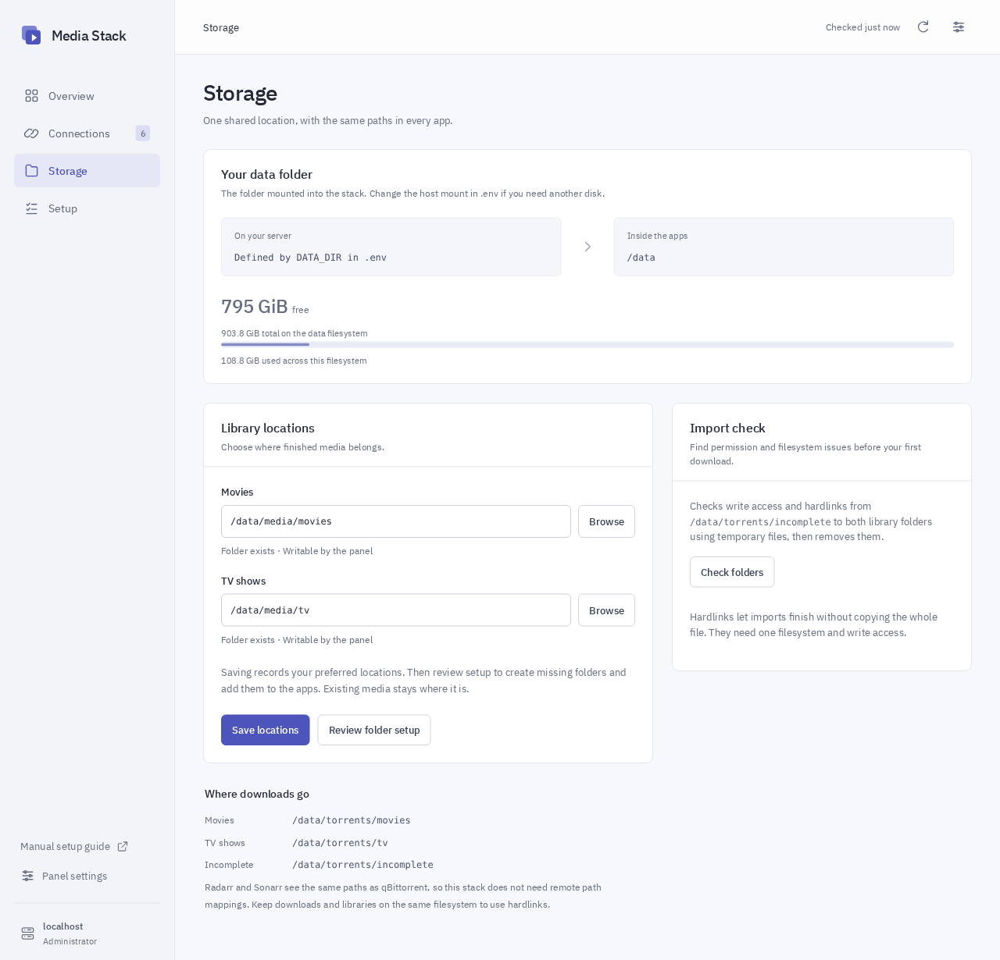

# Media Stack

A control panel for your own Jellyfin and ARR stack. Connect the apps, choose where files belong, and see what’s running from one place.

Media Stack runs on a Linux server or NAS with Docker Compose. It includes Jellyfin, Seerr, Radarr, Sonarr, and Prowlarr. Optional qBittorrent downloads run through Gluetun.

## What the panel does

- **Overview:** live service status, Jellyfin movie/show/episode counts, active streams, download speeds and progress, free storage, and app health warnings.
- **Connections:** verify and save app credentials. Connect the installed ARR apps and Seerr using local API keys without copying them through the browser.
- **Storage:** browse the shared data folder, choose movie/TV locations, and check write access and hardlinks.
- **Setup:** review and apply folder creation, Jellyfin libraries, ARR root folders, qBittorrent categories and download clients, Prowlarr sync, and Seerr connections with explicit quality profiles.

Existing connections and libraries are preserved. Setup adds missing settings, tests new app connections before saving, and reports partial failures. Retrying detects settings that already exist. It does not move media, change disk ownership, or rewrite existing app integrations.



_Storage screen from an isolated test install._

## Install

You need Linux, Python 3.9+ for the setup script, Git, and [Docker Engine with Compose v2.20+](https://docs.docker.com/engine/install/). The control panel’s Python runtime is included in its container. Run setup as the normal user who will own the media files, with permission to use Docker.

```bash
git clone https://github.com/0libote/Media-Stack.git
cd Media-Stack
python3 setup.py
docker compose config --quiet
docker compose up -d --build
```

Setup asks for a storage folder, your server’s LAN IPv4 address, timezone, and an optional provider WireGuard file. Use a dedicated storage folder that your user can write to. The default address, `127.0.0.1`, allows access from the server itself; enter its LAN address to use other devices at home.

Open **http://YOUR-SERVER-IP:8088**. Once the panel has started, read its one-time setup code from the server:

```bash
cat config/portal/setup-code
```

Enter that code in the panel and choose an administrator password. The code is removed after use. This account controls the panel; the other apps keep their own accounts.

For a server using a separate disk:

```bash
python3 setup.py --data-dir /srv/media-stack --bind-address 192.168.1.50 --timezone Europe/London
```

For local defaults without prompts, use `python3 setup.py --non-interactive`. Setup preserves an existing `.env`; edit that file directly to change an installed stack.

## First time through

1. Open Jellyfin and Seerr from the panel. Complete their own account setup and sign Seerr into Jellyfin using `http://jellyfin:8096` as the internal address. Create a Movies library at `/data/media/movies` and a Shows library at `/data/media/tv` in Jellyfin. In Seerr, sync and enable at least one of those libraries to finish its wizard. You can leave its ARR connections for the panel.
2. In **Connections**, choose **Connect local apps**. Add a Jellyfin API key from Dashboard → API Keys. If downloads are enabled, add qBittorrent’s permanent Web UI login. Use the default internal service addresses for this Compose stack.
3. In **Storage**, check the movie and TV locations. Saving preferences does not move files or change the apps; the next step applies the new locations.
4. In **Setup**, choose the tasks, review each change, then apply. Select your Radarr and Sonarr quality profiles if connecting Seerr.
5. Add your own indexers in Prowlarr. Try one request for media you’re allowed to download and check it reaches Jellyfin. Existing media can be watched without enabling downloads.

The [manual setup guide](portal/guide.html), also linked in the panel, walks through the individual apps. [Panel behavior and supported APIs](docs/control-panel.md) explains the managed settings and remaining manual steps.

## Shared storage

Every app sees your dedicated data folder at `/data`. Jellyfin’s mount is read-only. Consistent paths prevent the common “download finished but import failed” problem and allow hardlinks on a compatible filesystem.

```text
Your data folder/
├── media/
│   ├── movies/          ← Radarr and Jellyfin
│   └── tv/              ← Sonarr and Jellyfin
└── torrents/
    ├── movies/          ← qBittorrent movie category
    ├── tv/              ← qBittorrent TV category
    └── incomplete/
```

You can choose other library subfolders inside `/data` in the panel. Changing a library location adds a new root/library entry where possible; it does not relocate existing files or change the paths of movies and series already managed by the apps. Jellyfin name conflicts and download category conflicts are shown for review in the native app.

Keep this data folder dedicated to media and downloads. The library tools and panel can access everything under it. To use a different host disk, change `DATA_DIR` in `.env` and recreate the containers; the panel cannot mount host disks.

## Optional downloads

Provide a provider WireGuard configuration during setup, or follow [the downloads guide](docs/downloads.md) to add it later. qBittorrent shares Gluetun’s network and waits for the VPN health check. The panel does not expose Docker’s socket or change VPN credentials.

Only qBittorrent uses the VPN. Search, requests, and playback use the normal connection. A qBittorrent “Connected” badge means its API responded; it does not prove the VPN exit route. Verify that separately before relying on it.

## Keep it running

Run commands from this repository so Compose loads `.env`.

```bash
docker compose ps
docker compose logs --tail=100 portal
docker compose stop
docker compose up -d
```

Before updating, [back up the settings and media](docs/maintenance.md). Upstream app images follow stable channels and can change between installs. The panel’s Python dependencies are pinned with hashes.

```bash
git pull
docker compose pull --ignore-buildable
docker compose up -d --build
```

Use a trusted home network and finish the apps’ account setup before sharing their addresses. For an HTTPS reverse proxy, see [maintenance](docs/maintenance.md). Windows/macOS Docker Desktop, automatic disk migration, and GPU setup are outside this install flow. Hardware acceleration depends on the host; follow [Jellyfin’s guide](https://jellyfin.org/docs/general/post-install/transcoding/hardware-acceleration/).

## Ports

| Service                   | Port |
| ------------------------- | ---- |
| Media Stack control panel | 8088 |
| Jellyfin                  | 8096 |
| Seerr                     | 5055 |
| Radarr                    | 7878 |
| Sonarr                    | 8989 |
| Prowlarr                  | 9696 |
| qBittorrent, when enabled | 8080 |

## Development

The backend is Python/Flask, served by Gunicorn. The interface uses HTML, CSS, and browser JavaScript with bundled fonts; there is no frontend build step. See [development and validation](docs/development.md).

Project files use the [MIT license](LICENSE). Upstream apps and the bundled IBM Plex fonts retain their own licenses. Contributions should keep the install understandable and preserve users’ existing settings and files.
